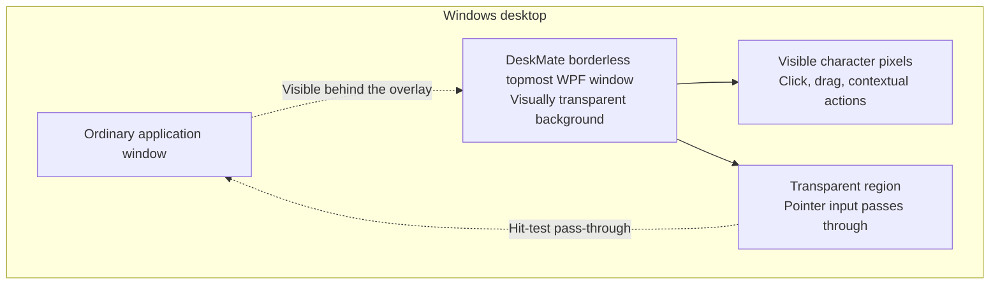
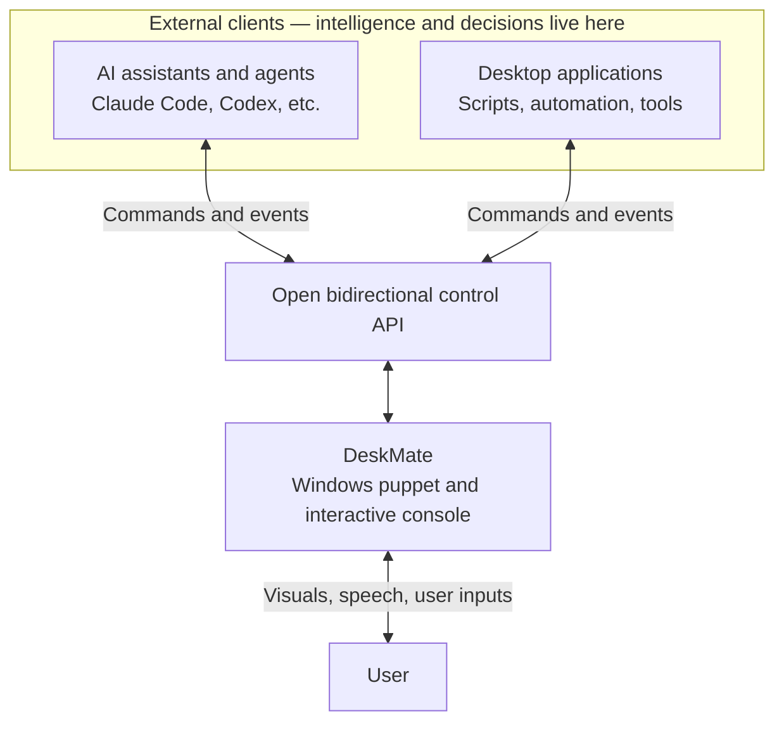
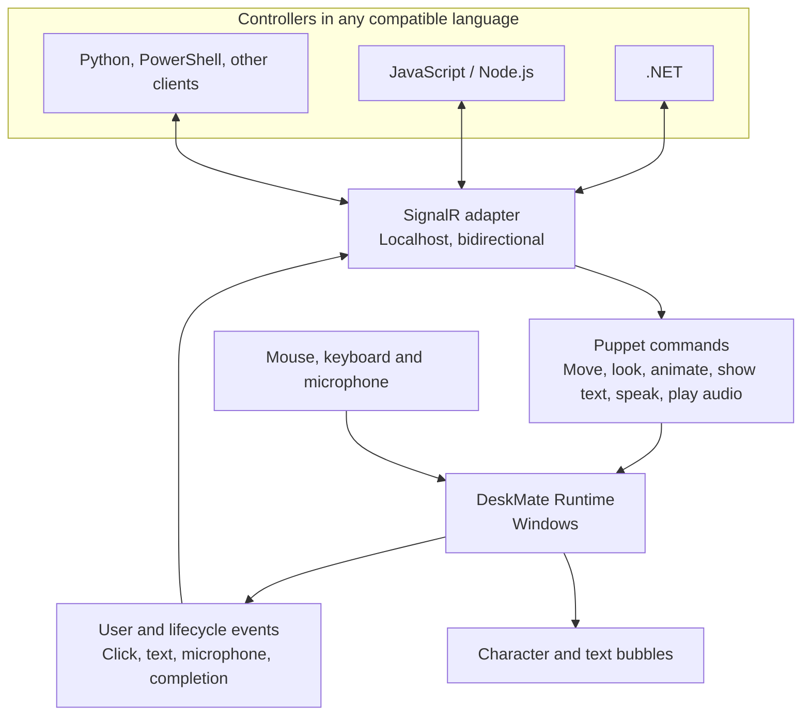
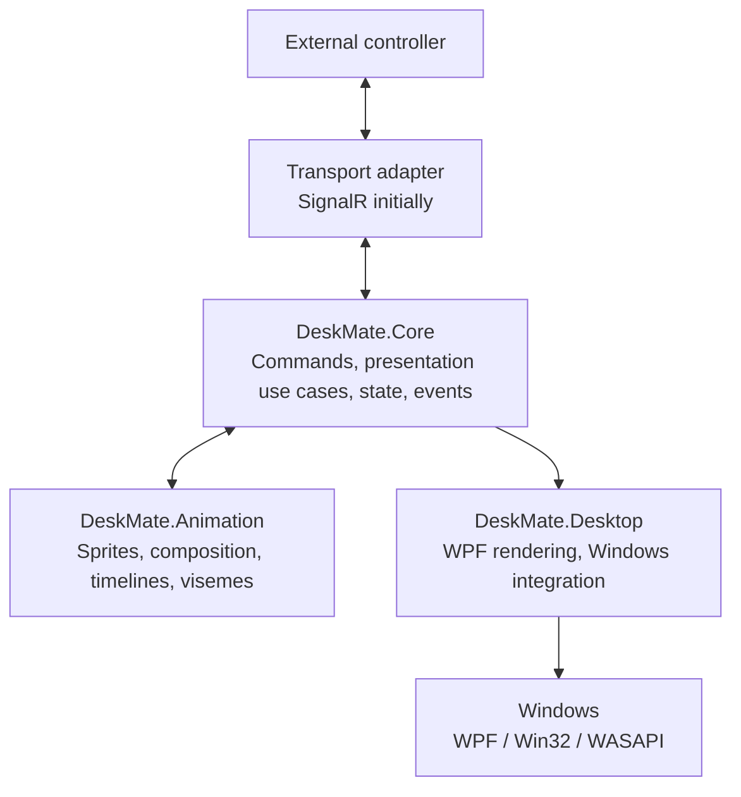
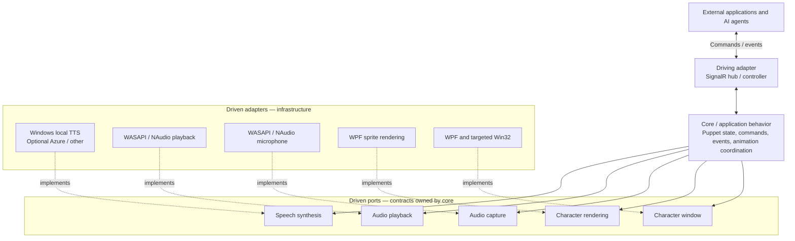
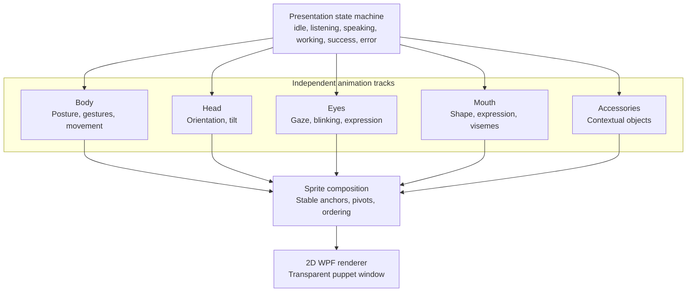
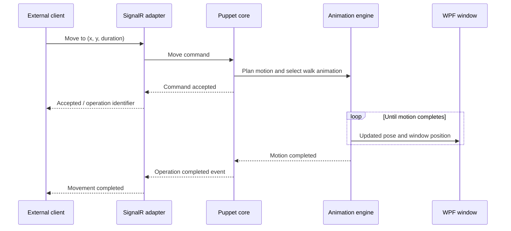
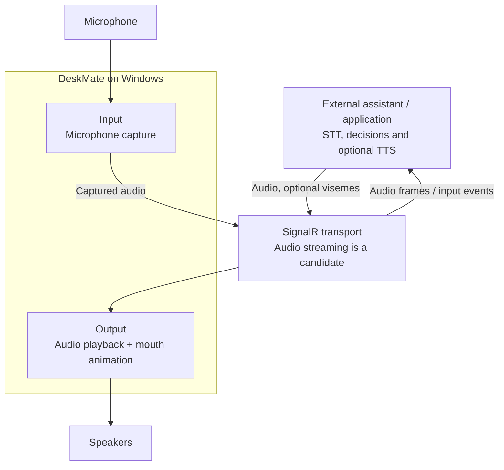
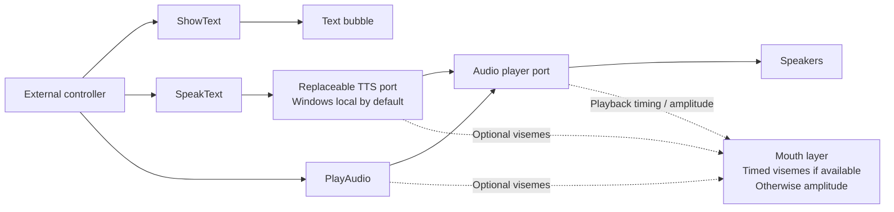
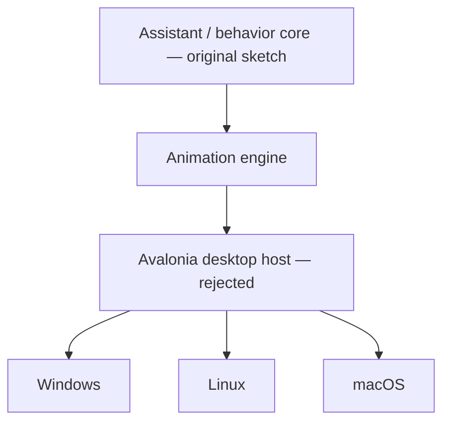

# DeskMate — Architecture diagrams

> **Status: design documentation (2026-11-11).** These Mermaid diagrams consolidate the architecture and interaction diagrams discussed during the initial design. GitHub renders them directly. Except for the final historical diagram, they describe the **current intended direction**, not implemented software. The exact assembly layout, API methods, and audio wire format are not frozen.

DeskMate is a **programmable Windows-native desktop puppet**, not an intelligent agent: external clients decide **what** should happen; DeskMate knows **how to present it**, and returns user interactions.

## 1. The transparent Windows desktop overlay

This is a conceptual sketch, not literal z-order wiring. The **visible character should receive input**, while its **transparent surroundings must not block normal applications**. Pixel-accurate hit-testing, focus, Win32 interoperability, DPI and multi-monitor behavior require prototype validation. See [ADR 0002](decisions/0002-windows-native-desktop.md).

## 2. System context: DeskMate is controlled from outside

The external program decides why the character moves or what it says. DeskMate can still do **technical presentation work** such as motion interpolation, animation transitions, playback, blinking, and lip sync; this is not AI reasoning. See [ADR 0001](decisions/0001-assistant-scope.md).

## 3. SignalR-first communication and interactive console

SignalR is the **initial** adapter; the command/event contracts should not require a .NET client library. Optional future JSON-RPC/WebSocket and MCP adapters must not become part of the puppet core. Method names and the concurrency/control policy remain open. See [ADR 0004](decisions/0004-open-control-api.md).

## 4. Architectural boundaries: core, animation, Windows host

This diagram presents **logical responsibilities and runtime collaboration**, not mandatory assembly dependencies. In source code, the implementation of outbound capabilities depends on core-owned ports, not the reverse. It is not necessary to create a separate project for each box.

## 5. Ports & Adapters — hexagonal architecture

**Solid arrows = runtime calls/data flow; dashed arrows = adapter implements port.** In terms of **source dependencies**, adapters depend inward on the ports/contracts defined by the core. No SignalR, WPF, Win32, NAudio, or speech-provider types leak into those contracts. Avoid speculative interfaces; the candidates above only become real ports when use cases justify them. See [ADR 0005](decisions/0005-ports-and-adapters.md).

## 6. Five composable sprite layers

Body animation, gaze, blinking and mouth motion can run concurrently. Small functional, expressive, and ambient animations can be combined; there is no need to draw every possible whole-character combination. See [ADR 0003](decisions/0003-layered-sprite-animation.md).

## 7. A command can drive a complete movement

The precise API method names, correlation/operation identifiers, cancellation, error handling and completion semantics are **illustrative**. This is how DeskMate can move without having to know its controller's intent.

## 8. Bidirectional voice: speakers and microphone

This is **input/output**, not a built-in speech assistant. Speech recognition and interpretation remain outside DeskMate. Microphone access, authorizations, buffering, interruption and latency require explicit design. See [ADR 0006](decisions/0006-voice-and-speech.md).

## 9. Three independent presentation capabilities: text, TTS and external audio

DeskMate can optionally synthesize **text supplied by a controller**, which is a presentation capability, not intelligence. Externally supplied audio remains a first-class alternative. Synchronize mouth sprites to **actual playback progress**, not to the arrival time of SignalR messages.

## 10. Historical sketch — cross-platform architecture **rejected**

The first exploratory diagram separated core, animation and host and suggested adapters for three operating systems. **This was superseded by the explicit Windows-only decision in ADR 0002.** It is retained only to preserve the design discussion, not as a roadmap.

**Current target:** WPF + targeted Win32 interoperability on Windows only. Additionally, the original "assistant core" was corrected to **puppet core**; agent orchestration is external.

## Open questions

- Single controlling application versus multiple simultaneous controllers; arbitration, permissions and priorities.
- Stable command and event schemas, operation completion/cancellation and transport authentication.
- Audio streaming formats, buffering, privacy, microphone access, voice providers and viseme timing.
- Practical per-pixel click-through and interaction behavior in WPF/Win32.
- Exact source project structure: follow use cases, not the number of diagram boxes.

## Related decisions

1. [0001 — Programmable puppet](decisions/0001-assistant-scope.md)
2. [0002 — Windows-native desktop](decisions/0002-windows-native-desktop.md)
3. [0003 — Layered sprite animation](decisions/0003-layered-sprite-animation.md)
4. [0004 — Open control API, SignalR first](decisions/0004-open-control-api.md)
5. [0005 — Ports & Adapters](decisions/0005-ports-and-adapters.md)
6. [0006 — Voice, TTS and microphone](decisions/0006-voice-and-speech.md)
